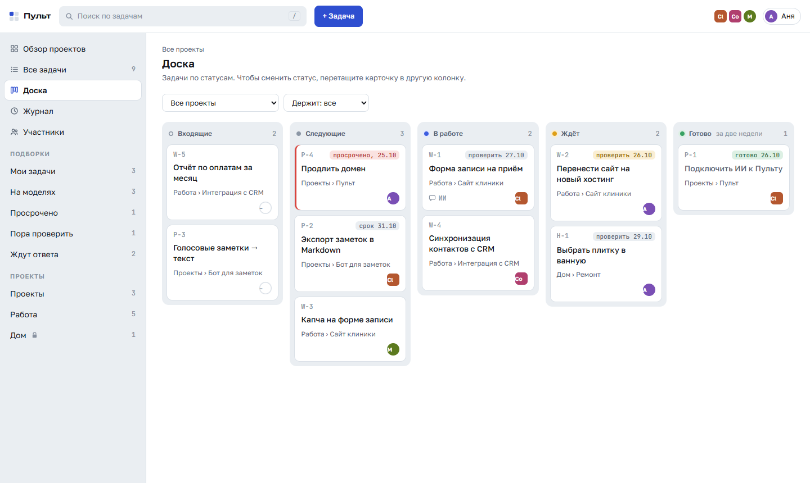
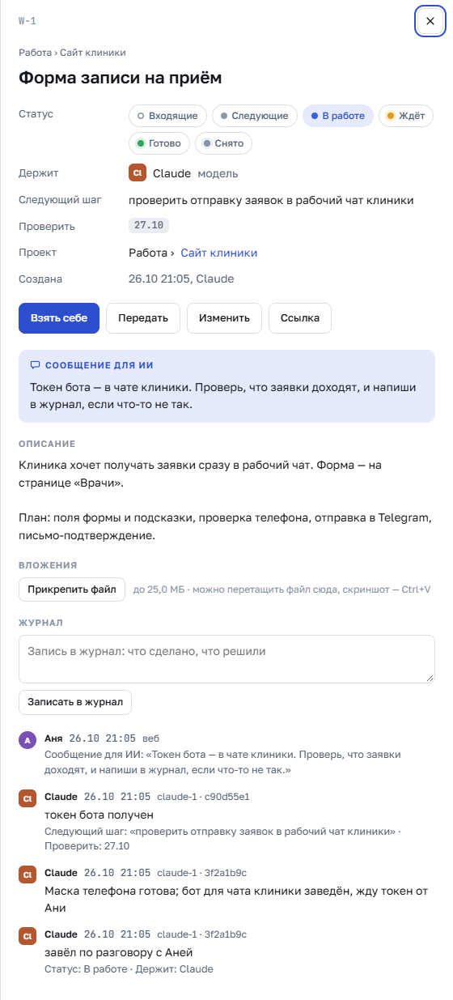

# Пульт

**Доска дел, которую ведёт ваш ИИ-агент.** Claude Code, Codex или любой агент, который умеет запускать
команды, в начале сессии читает из Пульта, что горит, а в конце сам двигает карточки: что сделано, что
дальше, чего ждём и когда проверить. Вы видите то же самое на странице — с компьютера или с телефона.

*In English: Pult is a tiny self-hosted board that your AI agents keep up to date. At the start of a
session the agent reads a brief; at the end it moves the cards itself, in one batch. One Python file plus
SQLite, no dependencies. The interface and the docs are in Russian.*



## Это не таск-менеджер

Таск-трекеры сделаны для команды людей: спринты, оценки, отчёты. Пульт — внешняя память о делах для
работы с ИИ.

- **Агент не помнит прошлых сессий.** Где остановились, что ждём и от кого — обычно размазано по чатам,
  заметкам и файлам HANDOFF, и каждую сессию это объясняют заново. С Пультом агент сам читает сводку в
  начале сессии и сам записывает итог в конце.
- **Карточка — для передачи дел, а не для отчётности.** Следующий шаг, «ждём … — проверить такого-то
  числа», кто держит, журнал. Новая сессия или другой агент продолжает с того места, где остановился
  предыдущий. Поручение агенту пишется прямо в карточке — «Сообщение для ИИ»: агент увидит его первым в
  сводке. Там же — с какой моделью и усилием работать: для всего Пульта, раздела, проекта или одной карточки.
- **Сроки не тонут в тексте.** Ожидание с датой проверки само всплывёт в сводке: «пора проверить»,
  «просрочено».
- **Несколько агентов и людей сразу.** У каждой модели свой ключ и не больше прав, чем у её хозяина.
  Журнал показывает, кто и из какой сессии что поменял. Правка по устаревшей версии карточки не затирает
  чужую: разные поля сливаются, одинаковые дают конфликт с объяснением, что поменялось.
- **Ничего лишнего.** Один файл Python без зависимостей и SQLite, около 15 МБ памяти; страница без внешних
  библиотек и без запросов наружу. Ставится на свой компьютер или на самый маленький сервер.

## Как это выглядит в работе

В начале сессии агент запускает `python pult.py brief`:

```
Пульт · 26.10 · открытых 9 · http://127.0.0.1:9447
Сообщения для ИИ (1) — поручения людей, начать с них
  W-1      Форма записи на приём · Работа › Сайт клиники · проверить отправку заявок в рабочий чат · проверить 27.10 · Claude
           «Токен бота — в чате клиники. Проверь, что заявки доходят, и напиши в журнал, если что-то не так.»
Просрочено (1)
  P-4      Продлить домен · Проекты › Пульт · оплатить у регистратора · ПРОСРОЧЕНО, срок 25.10 · Аня
Пора проверить (1)
  W-2      Перенести сайт на новый хостинг · Работа › Сайт клиники · ждём: доступ к панели хостинга · пора проверить, 26.10 · Аня
В работе (2)
  W-1      Форма записи на приём · Работа › Сайт клиники · проверить отправку заявок в рабочий чат · проверить 27.10 · Claude
  W-4      Синхронизация контактов с CRM · Работа › Интеграция с CRM · сопоставить поля карточки клиента · Codex
…
От других сессий Claude за два дня: 1 (сессии c90d55e1) — pult.py log --since 2d --by me
```

В конце сессии — один пакет, без вопросов к человеку:

```json
[
  {"op": "note", "key": "W-1", "text": "форма отправляет заявки, проверено на телефоне"},
  {"op": "done", "key": "W-1", "result": "заявки приходят в рабочий чат клиники"},
  {"op": "set", "key": "W-2", "wait": "ответ администратора клиники", "check": "+2"},
  {"op": "add", "project": "site", "title": "Капча на форме записи", "status": "next", "holder": "me"}
]
```

```
python pult.py apply ops.json
```

На странице у каждой карточки — журнал: кто из людей и агентов, в какой сессии и что поменял.



## Быстрый старт: Пульт на своём компьютере

Нужен только Python 3.9 или новее — сторонних пакетов нет.

```
git clone https://github.com/ArtYudin89/pult
cd pult
python server/pult_server.py init --db .local/pult.db --name "Аня"
python server/pult_server.py serve --plain-http --db .local/pult.db --backup-dir .local/backup
```

`init` создаёт базу, вас — владельца Пульта, модель Claude с ключом (другое имя — `--ai Codex`) и первую
карточку «Подключить ИИ к Пульту». Ссылка для первого входа — в `.local/login-<id>.txt` (на Windows —
двойной щелчок по `.url` рядом), ключ модели — в `.local/claude.token`, а `pult.py` уже настроен.
Проверка — `python pult.py whoami` и `python pult.py brief`.

Последний шаг — научить агента: вставьте в его инструкции (`CLAUDE.md` у Claude Code, `AGENTS.md` у
Codex) блок из [docs/for-ai.md](docs/for-ai.md).

Установку можно поручить самому агенту: «Поставь Пульт по https://github.com/ArtYudin89/pult и подключи
себя к нему». В [docs/for-ai.md](docs/for-ai.md#установка-по-просьбе-человека) для него есть порядок
действий; ссылку для входа агент не печатает, а называет файл, где она лежит.

Автозапуск и прочие подробности — [docs/install.md](docs/install.md).

## Пульт на сервере

Чтобы открывать Пульт с телефона, получать утреннюю сводку в Telegram и пускать других людей и их агентов,
поставьте его на сервер Linux с systemd. Хватит самого маленького VPS: службе отведено 80 МБ памяти, а
занимает она около 15.

```
git clone https://github.com/ArtYudin89/pult && cd pult
sudo sh deploy/install.sh        # первый раз — кладёт образец настроек в /etc/pult/pult.conf
sudo nano /etc/pult/pult.conf    # адрес, сертификат, ваше имя
sudo sh deploy/install.sh        # ставит службу, создаёт владельца и ключ модели
```

Сертификат, обратный прокси (Caddy, nginx), сводка в Telegram, копии базы, обновление —
[docs/install.md](docs/install.md#на-сервере).

## Кто как входит: агенты и люди

- **Ваш агент** работает через `pult.py` — клиент командной строки к HTTP API Пульта. Ключ модели выдаёт
  `init` или страница: «Участники» → модель → «Выдать ключ». На компьютере, где работает агент:
  `python pult.py connect https://сервер:9447 --token-file ключ.txt` (без `--token-file` ключ спросят,
  ввод не виден).
- **Человек** входит по одноразовой ссылке со сроком: «Участники» → «+ Человек» → «Выдать ссылку для
  входа». Ссылка открывается в браузере, и вход на этом устройстве помнится полгода.
- **Чужой агент** — например, Codex соразработчика — по ссылке не входит: ссылка для его хозяина-человека.
  Тот входит, заводит на странице свою модель («+ Модель») и выдаёт ей ключ. Модель видит и правит не
  больше, чем её хозяин. Работает она через `pult.py` или напрямую по HTTP с заголовком
  `Authorization: Bearer <ключ>`; описание API лежит на самом Пульте — `/static/api.txt`
  ([копия здесь](server/static/api.txt)).

## Права и защита

- **Владелец Пульта** видит и правит всё, заводит участников, разделы и проекты. **Участник** видит только
  проекты, к которым ему дали доступ: «читает» или «правит». Закрытые разделы и проекты (личное, работа)
  открываются только отдельным доступом — доступ «ко всем проектам» их не включает.
- Ключи, входы и приглашения хранятся только хешами. Ссылка для входа передаёт секрет после `#` — эту часть
  браузер не отправляет ни серверу, ни тем, кто строит превью ссылок.
- Запись со страницы принимается только с самой страницы (свой заголовок, свой `Origin`, куки
  `SameSite=Lax`), строгий CSP, страница не ходит наружу. Десять неудачных входов с одного адреса — пауза
  10 минут. Журнала запросов сервер не пишет.
- `init`, `invite` и `key` кладут ссылки и ключи в файлы и печатают только путь: секреты не попадают в
  вывод, а значит и в переписку с агентом.

## Устройство

| Что | Где |
|---|---|
| Сервер: HTTPS, API, страница, SQLite, копия базы раз в сутки — одна программа на стандартной библиотеке | `server/pult_server.py` |
| Страница: без внешних библиотек, шрифты свои | `server/static/` |
| Клиент командной строки для агентов и людей | `pult.py` |
| Описание HTTP API | `server/static/api.txt` |
| Установка на сервер: шаблоны служб systemd, образец настроек | `deploy/` |
| Проверки: 48 тестов; сравнение старой и новой версии на копии базы перед обновлением; страница в Chrome | `tests/` |

Статусы: входящие, следующие, в работе, ждёт, готово, снято. У задачи номер с префиксом раздела (`W-12`);
номер можно набирать и русскими буквами-двойниками. Каждое изменение пишется в журнал: кто, откуда
(страница, ключ, сессия агента), что было и что стало. Вложения — до 25 МБ каждое, 500 МБ всего; скриншот
вставляется в карточку через Ctrl+V.

## Ограничения

- Интерфейс, сообщения и документация — только на русском.
- Агенту нужно уметь запускать команды или отправлять HTTP-запросы; в чате без инструментов Пульт не
  поможет.
- Одна установка — одна база. Несколько независимых команд — несколько установок.
- Даты и сроки — по часам компьютера, где работает сервер.

## Лицензия

GNU AGPL v3 или новее, полный текст — в [LICENSE](LICENSE). Copyright (C) 2026 ArtYudin89.

Условие простое: берёте код — открывайте свой. AGPL, а не GPL, потому что Пульт — сервер: если вы
изменили его и даёте им пользоваться другим людям по сети, исходники изменённой версии нужно открыть
и им. Своя установка без изменений ничего не требует. Первые версии (коммиты 21f7ae1–1bfe770 от 26.10.2026)
вышли под MIT и у тех, кто их скачал, под MIT и остаются.

Шрифты в `server/static/fonts/` (Golos Text, JetBrains Mono, Unbounded) — SIL Open Font License 1.1,
см. [OFL.txt](server/static/fonts/OFL.txt); лицензия Пульта на них не распространяется.

## Поддержать

Пульт бесплатен. Если он экономит вам время — [DONATE.md](DONATE.md).
